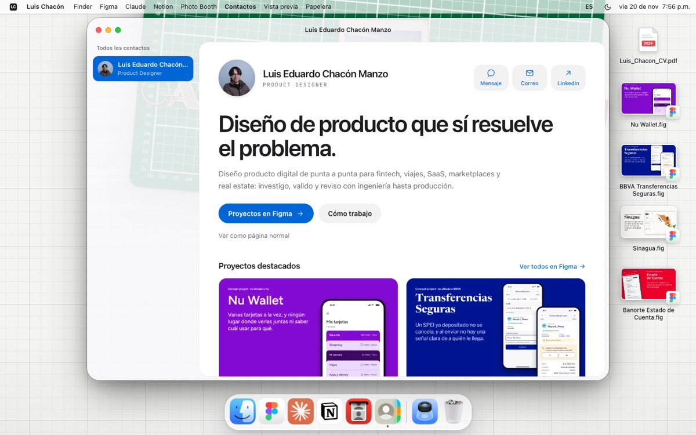

<div align="center">

# Luis Chacón · Product Designer

**A portfolio you can explore like a desktop.**

[**luis-chacon.com**](https://luis-chacon.com)



</div>

## What it is

My product design portfolio, built as a desktop: a menu bar, draggable windows, files and a dock.
Open **Figma** in the dock to browse the case studies, or switch to a **plain page** if you just want to read.

- **Case studies:** real projects and concept cases for fintech, travel, SaaS, marketplaces and real estate.
- **How I work:** from research and benchmarking to handoff, design QA and monitoring.
- **Experience** and **about me**, with downloadable CVs.
- **English and Spanish.**

## Stack

Next.js (App Router) · React · TypeScript · Tailwind CSS · deployed on Vercel.

## Run it

```bash
npm install
npm run dev
```

Content (case studies, experience, copy in both languages) lives in `src/lib/content.ts`.
